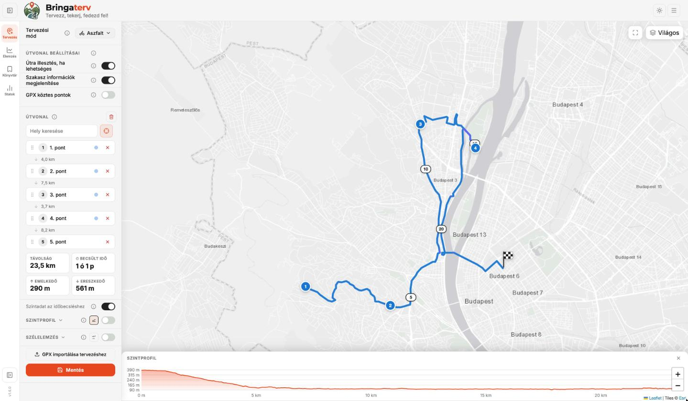
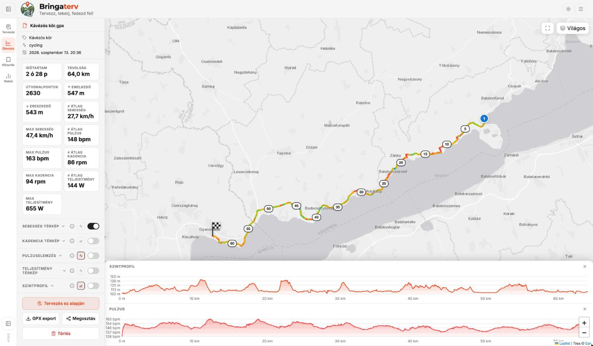
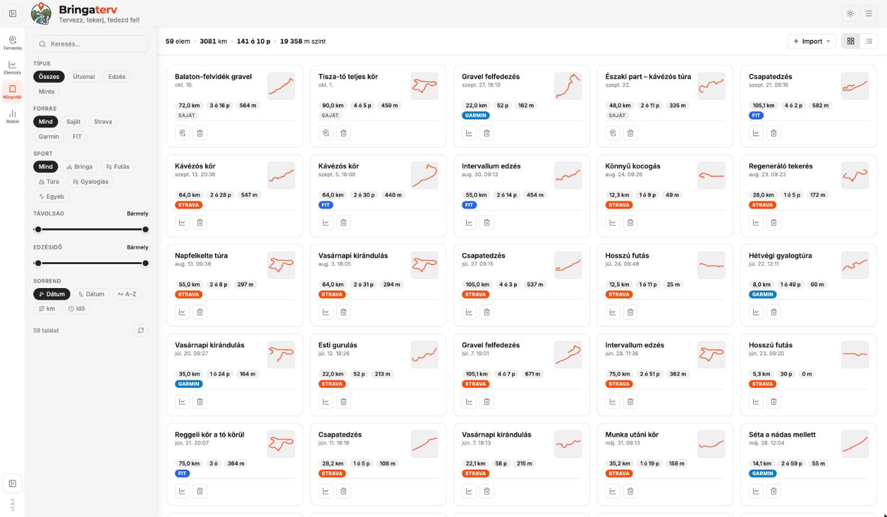
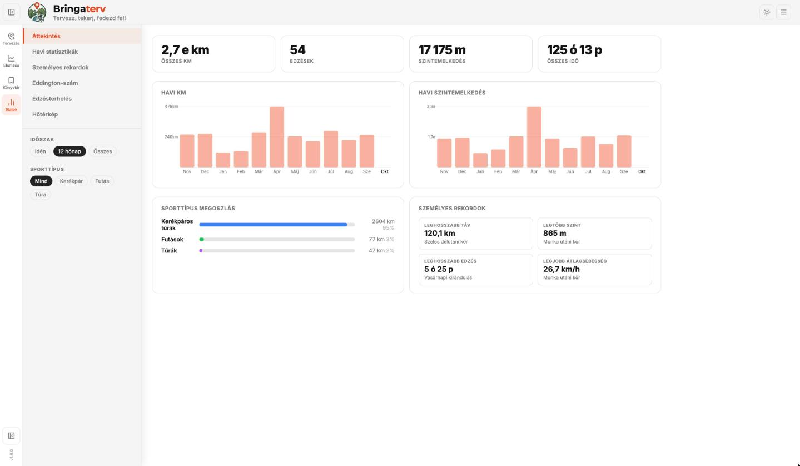
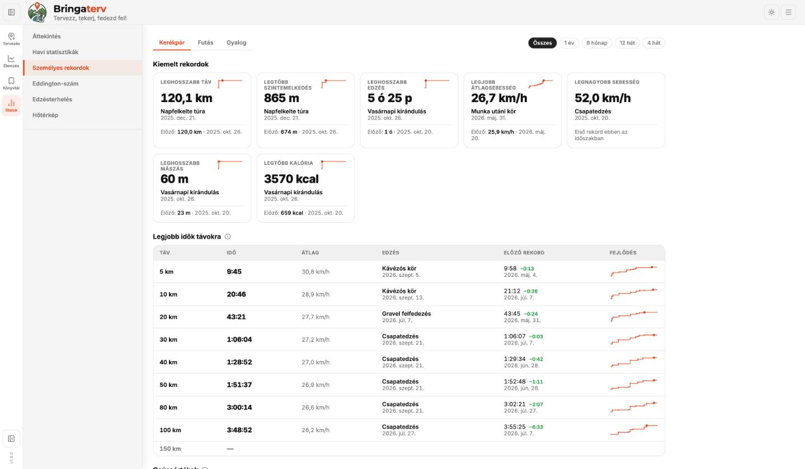
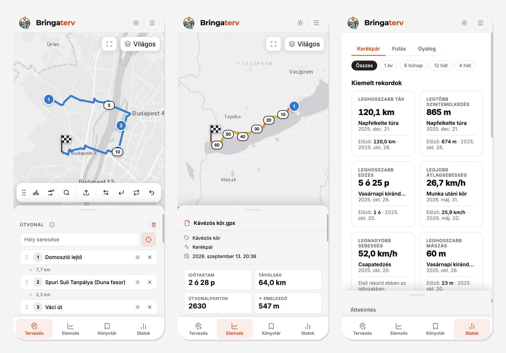

# Bringaterv


**Nyílt forráskódú, saját szerveren futtatható útvonaltervező és edzésnapló kerékpárosoknak, futóknak és túrázóknak.**
Böngészőben fut – asztali gépen és **telefonon is** –, Docker Compose-zal telepíthető. Tervezés, edzéselemzés, könyvtár, statisztikák és személyes rekordok, **Strava** és **Garmin Connect** szinkron egy helyen, a saját adataid felett.

> A képernyőképeken szereplő edzések és útvonalak kitalált demóadatok.



---

## Képernyőképek

### Elemzés
Sebesség / pulzus / kadencia / teljesítmény szerint színezett útvonal, egymás alatti diagramok, részletes edzésadatok.



### Könyvtár
Tervezett útvonalak és edzések egy helyen – forrás (Saját, Strava, Garmin, FIT) és sport szerinti szűrés, útvonal-bélyegkép, rács- és listanézet.



### Statisztikák
Havi táv és szintemelkedés, sportág-megoszlás, Eddington-szám, edzésterhelés, hőtérkép.



### Személyes rekordok
Kiemelt rekordok az előző rekorddal és fejlődési görbével, legjobb idők szabványos távokra, csúcspulzus és -teljesítmény.



### Mobil nézet
Ugyanaz az alkalmazás, külön telefonos elrendezéssel: teljes képernyős térkép, alsó navigáció, felhúzható panel – telefonon is lehet tervezni.



---

## Újdonságok

| Verzió | Főbb változások |
|---|---|
| **v1.7** | 📲 **Telepíthető app** iPhone-ra / iPadre / Androidra (App Store nélkül) · 🔄 **automatikus Strava import** · 🔔 **push értesítés** új edzésről és új rekordról · iPad-elrendezés |
| **v1.6** | 📱 **Mobil nézet** (alsó navigáció, felhúzható panel, tervezés telefonon) · 🏆 **Személyes rekordok** oldal (legjobb idők távokra, csúcsértékek, fejlődési görbék) · Inter betűtípus, súgók a beállítások mellett |
| **v1.5** | 🔗 **Megosztás**: nyilvános nézőoldal linkkel és QR-kóddal, megosztó kép, PDF egy helyről · edzésadatok (pulzus, kadencia, teljesítmény) a PDF-ben · egységes megjelenés |
| **v1.4** | 📄 **PDF útvonallap**: nyomtatható oldal térképpel, szintprofillal, adatokkal, útvonalpont-listával és QR-kóddal |
| **v1.3** | ⌚ **Garmin Connect**: edzés-import, testsúly-szinkron, útvonal küldése Garminra |
| **v1.0** | 🟠 **Strava** import, megújult könyvtár, kalória- és terhelésbecslés |

A teljes lista: [CHANGELOG.md](CHANGELOG.md)

---

## Funkciók

### Térképes tervezés
- Kattintással pontokat helyezhetsz el a térképen, vagy helyet kereshetsz név alapján
- 4 tervezési mód: Aszfalt, Gravel, MTB, Túra (gyalogos) – szakaszonként eltérő is lehet
- Útra illesztés BRouter segítségével – ha nem elérhető, egyenes vonalként jelenik meg
- Becsült menetidő a szintkülönbség és (szélelemzés után) a szél figyelembevételével
- Visszaút, oda-vissza és körút tervezés, közbeszúrás az útvonalra kattintással
- 7 térképstílus (Standard, Kerékpáros, Műholdas, Hybrid, Domborzat, Világos, Sötét), sötét és világos téma
- Útvonalpontok automatikus elnevezése (Nominatim), húzással átrendezhetők

### Edzéselemzés (GPX / FIT)
- GPX és FIT (Garmin / Wahoo / Bryton / Hammerhead) fájlok importálása, húzd-és-ejtsd bárhonnan
- Sebesség, pulzus, kadencia és teljesítmény szerint színezett útvonal, lejtőtérkép
- Szintprofil, sebesség, pulzus, kadencia és teljesítmény diagramok – a diagramon mozgatott egér a térképen is mutatja a pontot
- Pulzuszóna-elemzés (Karvonen, Max HR %, LTHR, egyedi határok), TRIMP

### Könyvtár
- Tervezett útvonalak és edzések mentése a szerverre, szerkesztés, visszatöltés
- Forrás szerinti jelölés és szűrés: **Saját**, **Strava**, **Garmin**, **FIT**; sport, táv és időtartam szűrő
- Rács- és listanézet útvonal-bélyegképpel, lenyitható részletekkel
- GPX és (ha van) eredeti FIT letöltés; edzésenként állítható, beleszámít-e a statisztikába
- Beépített minta útvonalak (Balatoni kör, Tisza-tó kör)

### Statisztikák és személyes rekordok
- Áttekintés: összesítők, havi táv és szint, sportág-megoszlás
- Havi bontás, **Eddington-szám**, **edzésterhelés** (CTL / ATL / TSB), **hőtérkép** az összes edzésből
- **Személyes rekordok** sportonként (Kerékpár / Futás / Gyalog) és időszakonként (összes, 1 év, 6 hónap, 12 hét, 4 hét):
  - kiemelt rekordok – leghosszabb táv, legtöbb szint, leghosszabb edzés, legjobb átlagsebesség, legnagyobb sebesség, leghosszabb mászás, legtöbb kalória – az előző rekorddal és fejlődési görbével
  - **legjobb idők távokra** (5 / 10 / 20 … 200 km, futásnál 400 m – maraton) a GPS-adatból számolva, akkor is, ha a táv egy hosszabb edzés közepén volt
  - **csúcsértékek**: legmagasabb átlagpulzus és -teljesítmény 5 mp – 60 perces ablakokra

### Megosztás és nyomtatás
- **Megosztás** ablak: megosztó kép (fotós témával is), PDF útvonallap, nyilvános link
- **Nyilvános nézőoldal**: a link / QR-kód bejelentkezés nélkül mutatja az útvonalat vagy edzést (szerkeszteni nem lehet); megosztás üzenetben, e-mailben, Facebookon stb.
- **PDF útvonallap**: térkép (választható stílus), adatok, szintprofil, edzésadatok, útvonalpontok, jegyzet, QR-kód kattintható linkkel
- A link címe beállítható (`SHARE_BASE_URL`), így helyi Docker-telepítésnél és saját domainnel is jó címre mutat

### Telepíthető app (iPhone, iPad, Android)
- A Bringaterv appként telepíthető, **App Store nélkül** – saját ikon, teljes képernyő, böngészősáv nélkül
- iPhone / iPad: Safari → **Megosztás** → **Főképernyőhöz adás**; Android / asztali Chrome, Edge: **Telepítés** gomb (☰ menü → „Telepítés appként”)
- iPaden álló és fekvő helyzetben is, a frissítés automatikus (új verzió telepítése után a következő indításkor)

### Mobil nézet
- 768 px alatt (és fekvő telefonon) saját elrendezés: teljes képernyős térkép, alsó navigációs sáv (Tervezés · Elemzés · Könyvtár · Statok)
- Az oldalsáv tartalma alulról felhúzható panelben, négy magasságban (húzással vagy koppintással)
- Telefonon is teljes értékű tervezés: keresés, útvonalpontok, eszköztár, mentés

### Strava integráció
- Felhasználónkénti Strava kapcsolat OAuth-tal, saját Strava app adatokkal; csak olvasási jog (`activity:read_all`) – a Bringaterv semmit nem ír a Stravára
- Aktivitások importálása pulzus / kadencia / teljesítmény adatokkal, kötegelve, duplikátum-felismeréssel
- Importált edzés metaadatainak frissítése (kalória, Relative Effort, teljesítmény, helyszín stb.)
- **Automatikus import**: 5 / 15 / 30 percenként vagy óránként a szerver magától behozza az új edzéseket (sportszűrővel, a Strava API-keretét figyelve)

### Értesítések
- Push értesítés a telefonra / tabletre / gépre: **új edzés importálva**, **új személyes rekord**, **Strava-kapcsolat megszakadt** – koppintásra megnyílik az edzés
- Beállítások → Értesítések: eszközönkénti engedélyezés, eseménykapcsolók, próbaértesítés
- Szabványos Web Push, külső szolgáltatás nélkül – **HTTPS kell hozzá**; iPhone-on / iPaden a főképernyőre telepített appból (iOS 16.4+)

### Garmin Connect integráció
- Belépés e-maillel és jelszóval, kétlépcsős azonosítással (MFA) – a jelszót nem tároljuk, csak a belépési tokent
- Edzés-import, testsúly-szinkron az okosmérlegről a kerékpáros profilba
- Tervezett útvonal küldése Garmin Connect course-ként navigációhoz

### Szélelemzés
- Open-Meteo alapú szél- és időjárás-előrejelzés a tervezett útvonalra (7 nap, óránként)
- Szakaszonkénti hátszél / oldalszél / szembeszél, térképszínezés, hatás a becsült menetidőre a kerékpáros profil (tömeg, CdA, Crr) alapján

### Testreszabás
- Sebesség-, kadencia-, teljesítmény- és pulzuszónák csúszkákkal, élő előnézettel
- Diagram színek (egyszínű vagy zónaszín), eszköztár sorrend, induló nézet, mértékegység
- Súgó („i”) gomb a beállítások mellett: koppintásra nyíló magyarázat

### Több felhasználó, admin, mentés
- JWT autentikáció, felhasználónkénti adatok és beállítások
- Admin panel: felhasználók, kvóták, útvonalak, minta útvonalak kezelése
- Teljes profil mentése és visszaállítása ZIP-ben (Beállítások és admin felület)
- Bejelentkezés kikapcsolható (`LOGIN_ENABLED=false`) otthoni hálózaton

---

## Telepítés telefonra / tabletre

1. Nyisd meg a Bringaterv címét a telefonon – **HTTPS-sel**, ha értesítést is szeretnél (pl. saját domain, Cloudflare Tunnel, reverse proxy).
2. **iPhone / iPad:** Safari → Megosztás gomb (□↑) → **Főképernyőhöz adás** → Hozzáadás.
   **Android:** Chrome → ⋮ → **Alkalmazás telepítése** (vagy az app ☰ menüjében: „Telepítés appként”).
3. Indítsd az új ikonról, és jelentkezz be (az iOS az appot a Safaritól külön kezeli, ezért egyszer újra kell).
4. Értesítésekhez: ☰ → Beállítások → **Értesítések** → **Engedélyezés**, majd **Próbaértesítés**.

> Sima `http://` címen (pl. helyi hálózati IP) az app is telepíthető, de a push értesítés és a gyorsítótárazás csak HTTPS-en működik.

---

## Architektúra

```
Böngésző (asztali / mobil)
    │
    ├── /            statikus frontend, /view.html nyilvános nézőoldal
    │                nginx konténer
    │
    └── /api/        REST API proxy
                     nginx → routes-api konténer (Flask)
                              │
                         routes-data volume (/data)
                         ├── bringaterv.db   ← SQLite (felhasználók, munkamenetek)
                         └── users/          ← felhasználónkénti GPX / FIT könyvtárak
```

| Konténer | Kép | Feladat |
|---|---|---|
| `bringaterv` | `ghcr.io/czdanika/bringaterv:latest` | nginx – statikus frontend |
| `routes-api` | `ghcr.io/czdanika/bringaterv-api:latest` | Flask REST API – JWT auth, GPX tárolás, rekordszámítás |

A `routes-api` konténer kívülről **nem érhető el** – csak az nginx-en keresztül, belső hálózaton kommunikál.

---

## Portainer telepítés (ajánlott)

### 1. Stack létrehozása

1. Portainer → **Stacks** → **Add Stack**
2. Stack neve: `bringaterv`
3. Válaszd a **Web editor** fület
4. Illeszd be az alábbi konfigurációt:

```yaml
services:
  bringaterv:
    image: ghcr.io/czdanika/bringaterv:latest
    ports:
      - "8088:80"
    environment:
      LOGIN_ENABLED: true
      SHARE_BASE_URL: ""                  # pl. https://bringaterv.example.hu (üresen: a böngésző címe)
    depends_on:
      - routes-api
    networks:
      - bringaterv-net
    restart: unless-stopped

  routes-api:
    image: ghcr.io/czdanika/bringaterv-api:latest
    environment:
      SAMPLES_DIR:     /samples
      DB_PATH:         /data/bringaterv.db
      MULTI_DATA_DIR:  /data/users
      PUBLIC_SHARE_ENABLED: "true"        # false → nyilvános nézőoldal kikapcsolva
      ADMIN_EMAIL:     admin              # ← admin belépési név / e-mail
      ADMIN_PASSWORD:  ide-ird-a-jelszot  # ← saját, erős jelszót adj meg!
      JWT_SECRET:      valtozd_meg        # ← kötelező megváltoztatni élesben!
    volumes:
      - routes-data:/data
    networks:
      - bringaterv-net
    restart: unless-stopped

volumes:
  routes-data:

networks:
  bringaterv-net:
    driver: bridge
```

5. Kattints a **Deploy the stack** gombra

Az alkalmazás elérhető: **http://[szerver-ip]:8088** – belépés az `ADMIN_EMAIL` / `ADMIN_PASSWORD` párossal.

> Az admin felhasználó az **első indításkor** jön létre ezekből az értékekből. Később a jelszó az admin felületen módosítható; a változók átírása a már létező felhasználót nem változtatja meg.

### 2. Környezeti változók

| Változó | Konténer | Leírás | Alapértelmezett |
|---|---|---|---|
| `LOGIN_ENABLED` | bringaterv | Bejelentkezés be/ki | `true` |
| `SHARE_BASE_URL` | bringaterv | A megosztott linkek / QR-kódok alap-címe (pl. saját domain). Üresen a böngésző aktuális címe; a Beállításokban felülírható | – |
| `ADMIN_EMAIL` | routes-api | Az első admin felhasználóneve / e-mail címe | `admin@bringaterv.local` |
| `ADMIN_PASSWORD` | routes-api | Az első admin jelszava – **saját értéket adj meg!** | – |
| `JWT_SECRET` | routes-api | JWT aláíró kulcs – **élesben kötelező megváltoztatni!** | `change-me-please` |
| `JWT_EXPIRY_DAYS` | routes-api | Token élettartama napban | `30` |
| `PUBLIC_SHARE_ENABLED` | routes-api | Nyilvános nézőoldal (megosztott linkek) engedélyezése | `true` |
| `STRAVA_AUTO_SYNC` | routes-api | Az automatikus Strava import háttérszála (`false` → kikapcsolva) | `true` |
| `NOTIFY_CONTACT` | routes-api | Kapcsolati cím a push értesítésekhez (VAPID `sub`, `mailto:` vagy `https:`) | a projekt GitHub-címe |

#### A `JWT_SECRET` beállítása

A bejelentkezési tokenek aláírására szolgál. Aki ismeri, érvényes tokent tud hamisítani bármely felhasználó (akár az admin) nevében, ezért éles üzemben **kötelező** sajátra cserélni.

- **Formátum:** hexadecimális string (csak `0–9` és `a–f`), így nincs benne speciális karakter, ami a YAML-ben gondot okozna.
- **Hossz:** legalább 32 byte = 64 hex karakter (256 bit), a HS256 algoritmushoz ajánlott kulcsméret.
- **Generálás:**

```bash
openssl rand -hex 32
```

> A `JWT_SECRET` megváltoztatásakor minden korábban kiadott token érvénytelenné válik, így mindenkinek újra be kell jelentkeznie.

### 3. Frissítés új verzióra

1. Portainer → **Stacks** → `bringaterv`
2. **Pull and redeploy**

> A `routes-data` volume frissítéskor megmarad – a mentett útvonalak, edzések és felhasználói adatok nem vesznek el.

### 4. Hibaelhárítás – mentés nem működik

**a) Elérhető-e az API?** Böngészőben: `http://[szerver-ip]:8088/api/health` → helyes válasz: `{"ok": true}`

**b) API napló:** Portainer → Containers → `bringaterv_routes-api_1` → Logs – keress `PermissionError`, `OSError` vagy `500` sort.

**c) Írási jog:** Portainer → Containers → `bringaterv_routes-api_1` → Console → Exec

```bash
touch /data/users/test.txt && echo "ÍRHATÓ" || echo "NEM ÍRHATÓ"
```

Ha `NEM ÍRHATÓ`: Portainer → Volumes → töröld a `bringaterv_routes-data` volume-ot, majd deployold újra a stacket (csak friss telepítésnél, ha még nincs benne fontos adat).

**d) Image frissítése kézzel:**

```bash
docker pull ghcr.io/czdanika/bringaterv-api:latest
docker pull ghcr.io/czdanika/bringaterv:latest
```

Majd Portainer → Stacks → `bringaterv` → Stop → Start.

---

## NAS / parancssoros telepítés

```bash
mkdir -p /volume1/docker/bringaterv
cd /volume1/docker/bringaterv

curl -o docker-compose.yml \
  "https://raw.githubusercontent.com/czdanika/bringaterv/main/docker-compose-nas.yml"

# Indítás előtt írd át a fájlban az ADMIN_PASSWORD és JWT_SECRET értékét!
docker compose pull
docker compose up -d
```

Frissítés:

```bash
cd /volume1/docker/bringaterv
docker compose pull
docker compose up -d
```

---

## Linux / Raspberry Pi telepítés

Bármilyen Linux gépen (Ubuntu, Debian, Raspberry Pi OS) működik, ahol fut a Docker.

```bash
# Docker telepítése (ha még nincs)
curl -fsSL https://get.docker.com | sh
sudo usermod -aG docker $USER
newgrp docker

# Bringaterv
mkdir -p ~/bringaterv && cd ~/bringaterv
curl -o docker-compose.yml \
  "https://raw.githubusercontent.com/czdanika/bringaterv/main/docker-compose-nas.yml"
# Indítás előtt írd át a fájlban az ADMIN_PASSWORD és JWT_SECRET értékét!
docker compose pull
docker compose up -d
```

Az alkalmazás elérhető: **http://[eszköz-ip]:8088** (Raspberry Pi-n az IP: `hostname -I`).

A `restart: unless-stopped` miatt újraindítás után automatikusan elindul. Frissítés: `docker compose pull && docker compose up -d` – az adatok a `routes-data` volume-ban megmaradnak.

---

## Helyi fejlesztés

```bash
git clone https://github.com/czdanika/bringaterv.git
cd bringaterv
docker compose up -d --build
```

Az alkalmazás elérhető: **http://localhost:8088**

---

## Licenc

MIT License – szabad felhasználás, módosítás és terjesztés.

---

*Készítette: [@czdanika](https://github.com/czdanika) · © Czibolya Dániel 2026*
